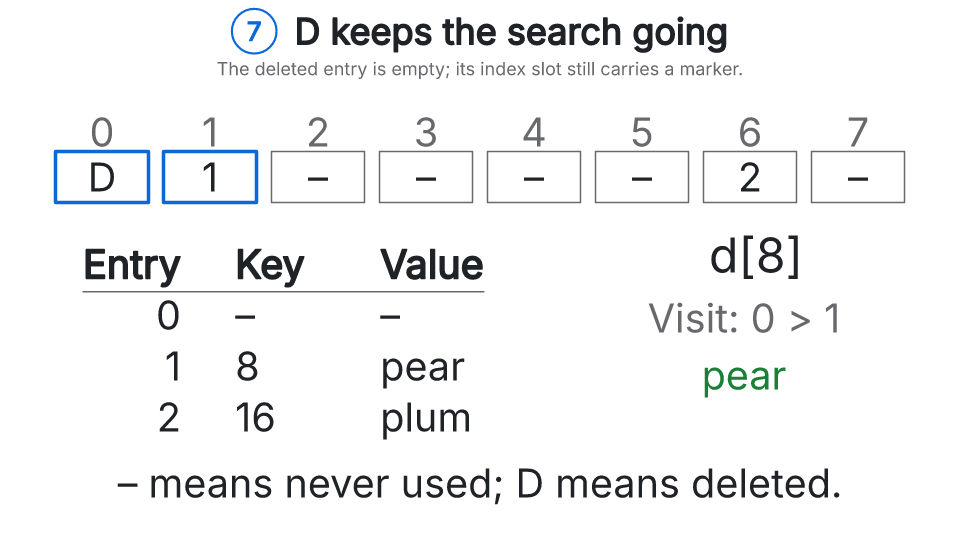

# Rayner: interactive technical explanations from TypeScript

Rayner turns a TypeScript model into a step-through explanation. Readers can change a setting and see how the result changes; authors publish the cases as a portable HTML page with a transcript. It is for engineers and technical educators explaining protocols, algorithms and code changes.

[](https://oshineye.dev/projects/rayner/python-dict)

## Start with a question

[Why does a deleted dictionary slot need a marker?](https://oshineye.dev/projects/rayner/python-dict) Follow a lookup, try deleting a slot, and see why clearing it can make an existing key disappear. [Read the scene](scenes/explainers/python-dict/scene.ts) to see how the model supplies the picture and caption.

[Browse the subject lessons](https://oshineye.dev/projects/rayner/) · [Write your first scene](docs/TUTORIAL.md) · [API and CLI reference](docs/REFERENCE.md)

## Write your first scene

Requires Node 24 or later and Chromium. Authoring targets Ubuntu and macOS; Windows is not yet supported. In an empty directory, install the published package and start the tutorial's two-case explainer of LRU and MRU cache replacement:

```sh
mkdir my-rayner && cd my-rayner
npm init -y
npm pkg set type=module
npm install --save-dev rayner
npx playwright-core install chromium
npx rayner init my-explainer
npx rayner preview my-explainer/scene.ts --watch
```

Open the localhost URL printed by `preview`. Switch between **A B C D again** and **C D C D**, edit `my-explainer/scene.ts`, then reload to see the rebuilt page. `init` also writes the scene's model, `model.ts`, and a test of it against published examples, `model.test.ts`. If Chromium is already installed, set `CHROMIUM_EXECUTABLE_PATH` instead of downloading it.

When your explanation is ready, review every case and save the page to publish:

```sh
npx rayner review my-explainer/scene.ts --out public/my-explainer.html
```

`review --out` checks every case, audits the served page at phone and desktop widths, and saves that exact HTML with its receipt, header recipe and loader. Check the model against its sources and inspect the screenshots: automated checks cannot establish that an explanation is true. [The tutorial](docs/TUTORIAL.md) develops a complete explainer; [publishing](docs/PUBLISHING.md) covers hosting and embedding it.

## Look up an authoring feature

The [feature tour](https://oshineye.dev/projects/rayner/feature-tour) is an **API demo**, not a lesson or a complete inventory. Choose a feature to start at **Recipe**, where the code an author writes appears; then advance to **Result**. Its excerpts need the surrounding scene to run; the [feature guide](docs/FEATURE-TOUR.md) links the full source and specialized setup. Direct links to a Result step still work.

## Work from this repository

Build the full local gallery when developing or reviewing Rayner itself:

```sh
git clone https://github.com/adewale/rayner && cd rayner
npm ci
npx playwright-core install chromium
npm run demos:build
npm run demos:serve
```

Open http://127.0.0.1:5175/explainers/. For a source change, run `npm run check` and `npm test`; [testing guidance](docs/TESTING.md) covers browser and capture checks. Report bugs in [GitHub issues](https://github.com/adewale/rayner/issues), with the scene, case, step and viewport needed to reproduce them. [The release guide](docs/RELEASING.md) records platform validation and the separate maintainer publishing workflow.

## Scope and limits

Scenes are ordinary TypeScript classes. Reader settings are finite choices, with every combination built ahead of time. Diagrams are captured from [Agentic Mermaid](https://github.com/adewale/agentic-mermaid) at build time; authors can also draw native shapes, charts, code diffs and camera moves. The browser loads no diagram renderer, and the page makes no runtime network requests.

- Default text uses embedded Inter and JetBrains Mono. Additional scripts, replacement faces, real bold and italic, and typeset maths need explicit [lettering requests](docs/LETTERING.md). New lettering capture needs Python and source fonts; committed snapshots replay without them.
- Paragraph direction follows the text. Authors can also choose [card field order and logical panel placement](docs/REFERENCE.md#stage) with `direction: 'rtl'`. Mermaid graph direction remains explicit in its source (`graph LR`, `graph RL`, and so on).
- Diagram labels fit captured widths by default. Opt into [`lettering: 'natural'`](docs/LETTERING.md#diagram-measurements) to measure the requested face before layout. A diagram style does not implicitly select its font.
- Player controls and generated picture descriptions are available in English and French. Other caption languages retain English controls and descriptions.
- Phones use close-ups and a **Next view** tour. Review the opening and the whole tour so the caption's subject remains visible.
- Builds enforce 1.5 MiB raw HTML and 450 KiB gzip page budgets. Diagram snapshots expand through the browser's native `DecompressionStream` API; the transcript remains readable without JavaScript. Split a scene or reduce its cases when it exceeds a budget.
- The example models are small and cited. They have not had subject-expert review.

[FAQ](FAQ.md) · [Engine guides](docs/ENGINE.md) · [Agent authoring skill](skills/rayner-explainers/SKILL.md) · [Changelog](CHANGELOG.md)

## License and attribution

Rayner is [MIT](LICENSE), maintained by [Ade Oshineye](https://github.com/adewale), and forked from Ivar Vong's [Lantern](https://github.com/ivarvong/lantern) at `2c7bad5`. [Upstream](docs/UPSTREAM.md) records the engine changes. Embedded font and glyph notices ship in `vendor/licenses/`. Neither Lantern nor Agentic Mermaid endorses this fork.
