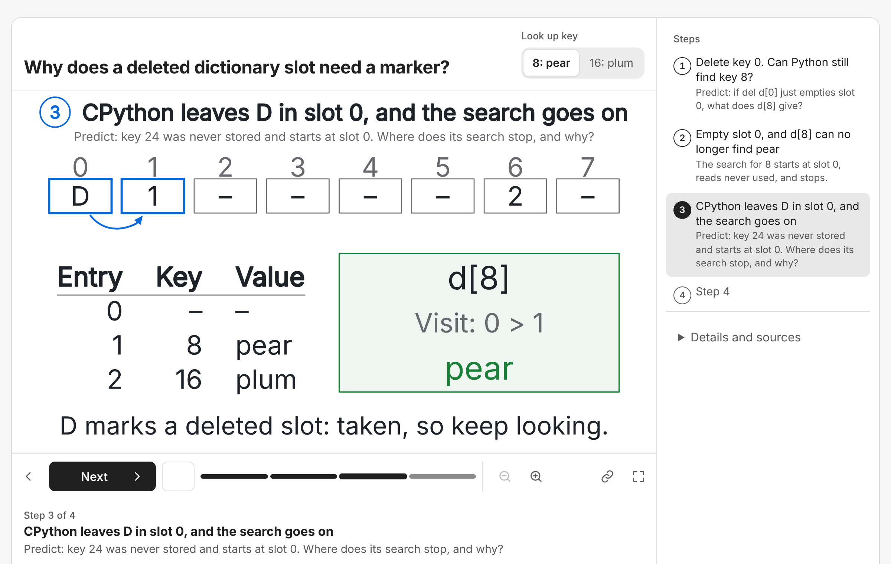
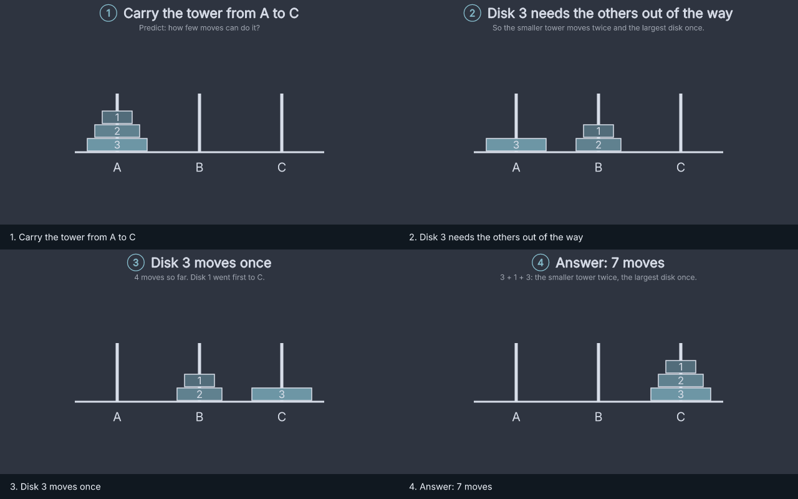

# Rayner

Rayner makes a verified explanation of what this version of this system really does, with a short receipt the person who commissioned it can review. It is for the person who commissions an explainer of a protocol, an algorithm or a data structure, and for the agent or person who writes it.

The writer models the system in TypeScript and tests the model against the real system where it can: run live, recorded once, or read from its specification. Every picture on the page is checked against the model’s state, and the receipt says what the model was checked against and how. The result is one HTML page of steps and a transcript, with no runtime network requests.

Each step records the model's state, and `rayner check` fails a picture that differs from what that state draws: every view at the end of every step, every staged step, and every machine state a reader can reach. Two kinds of picture are checked another way: a Mermaid diagram against the renderer's output pinned beside the scene, and a hand-placed callout only by the scene's own tests. The page opens from a file, a static host or an embed.

A picture of a Python dict after `del d[0]` is easy to draw wrong. Draw slot 0 empty and a later lookup for key 8 stops there and misses it; CPython instead leaves a deleted marker that sends the search on. In Rayner the dict is a TypeScript model checked against CPython 3.12’s own storage, each step is drawn from the model’s state, and `rayner check` fails a picture that disagrees with that state.

[](https://oshineye.dev/projects/rayner/python-dict)

How closely a model matches its subject varies from explainer to explainer. Each page's receipt, and the table below, say what it was checked against and how: **live** (the model's tests run the system each time), **recorded** (the system was run once and its answers frozen), **read** (a specification or source was read, not run) or **none** (only the model's own tests).

| Explainer | Its model is checked against | How |
|---|---|---|
| [Why does a deleted dictionary slot need a marker?](https://oshineye.dev/projects/rayner/python-dict) | CPython 3.12’s dict storage, read from memory | live |
| [Why does a merge sometimes need a new commit?](https://oshineye.dev/projects/rayner/git-branches) | Git repositories the test builds and merges | live |
| [Can this Rust value cross a thread boundary?](https://oshineye.dev/projects/rayner/send-sync) | rustc, compiling the model’s claims; the table is rustc 1.99.1’s | live |
| [Why can int4 and int8 rows take the same space?](https://oshineye.dev/projects/rayner/pg-page) | A Postgres 18.6 server, measured on 2026-10-25 | recorded |
| [Which address should Express call the client?](https://oshineye.dev/projects/rayner/trust-proxy) | Express 5.3.0, run once over a real HTTP connection | recorded |
| [Where does an empty ext4 filesystem’s space go?](https://oshineye.dev/projects/rayner/ext4-space) | mkfs.ext4 1.47.3 on Linux 6.8.0, for 22 filesystem sizes | recorded |
| [How does a token bucket let a burst through but refuse a flood?](https://oshineye.dev/projects/rayner/token-bucket) | Go’s `golang.org/x/time/rate` v0.15.0 limiter | recorded |
| [What is a statechart, and why use one instead of a state machine?](https://oshineye.dev/projects/rayner/statecharts) | The states and transitions XState 5.33.3 reaches | recorded |
| [Does isdigit guarantee int can parse it?](https://oshineye.dev/projects/rayner/isdigit) | CPython 3.15.1’s answers and Unicode 17.0.0’s data files | recorded |
| [Why does a Bloom filter answer “maybe”?](https://oshineye.dev/projects/rayner/bloom-filter) | An independent FNV-1a hash in CPython 3.12; the filter is a teaching model, not a production one | live |
| [Why does the north have summer when Earth is farthest from the Sun?](https://oshineye.dev/projects/rayner/seasons) | A cited approximation of the Sun’s path, not validated against an almanac | none |

Each explainer’s `script.md` says what its model is checked against, how, and what it leaves out; [testing](docs/TESTING.md#oracles-ci-runs-and-recordings) lists which outside systems CI runs and which are recordings. The [Bloom filter’s scene](https://github.com/adewale/rayner/blob/main/scenes/explainers/bloom-filter/scene.ts) shows a model supplying a picture and its caption. [All explainers](https://oshineye.dev/projects/rayner/)

## Quick start

Requires Node 24 or later and Chromium. Authoring targets Ubuntu and macOS; Windows is not yet supported.

These steps are for Rayner 0.2.0, the version this repository describes. Check what npm has with `npm view rayner-cli versions`. Until it lists 0.2.0 (npm's `rayner` 0.1.0 is an earlier, single-package release whose `init` writes a different starter, and there is no `rayner-cli` before 0.2.0), build both packages from a clone and install them from there:

```sh
git clone https://github.com/adewale/rayner
(cd rayner && npm ci && npm pack && cd cli && npm pack --pack-destination ..)
mkdir my-rayner && cd my-rayner
npm init -y
npm pkg set type=module
npm install --save-dev ../rayner/rayner-0.2.0.tgz ../rayner/rayner-cli-0.2.0.tgz
npx playwright-core install chromium
npx rayner init my-explainer
npx rayner preview my-explainer/scene.ts --watch
```

Once npm lists 0.2.0 for both packages, `npm install --save-dev rayner@0.2.0 rayner-cli@0.2.0` replaces the clone and the two archives.

If Chromium is already installed, set `CHROMIUM_EXECUTABLE_PATH` instead of downloading it.

Rayner is two packages at one version. `rayner` is what scenes import: the vocabulary, the drawing kit and the runtime, with no dependencies. `rayner-cli` is the `rayner` command, with the player it bundles into each page and the tools that capture diagram and lettering snapshots (esbuild, TypeScript, Agentic Mermaid, Playwright, svgpath and resvg); it requires `rayner` at exactly its own version.

`init` writes the tutorial’s explainer of LRU and MRU cache replacement: the script (`script.md`), the model (`model.ts`), the model’s test (`model.test.ts`) and the scene (`scene.ts`). Open the URL `preview` prints (port 5174 by default) and switch between **A B C D again** and **C D C D**. Edit `my-explainer/scene.ts` and reload to see the rebuilt page.

When the explanation is ready, review every scenario and save the page:

```sh
npx rayner review my-explainer/scene.ts --out public/my-explainer.html
```

`review --out` checks every scenario, audits the served page at phone and desktop widths, and saves that exact HTML with its receipt, a response-header recipe and its loader. [The tutorial](docs/TUTORIAL.md) builds a complete explainer; [publishing](docs/PUBLISHING.md) covers hosting and embedding it. `npx rayner init --machine` writes the other starter, a door that locks, for explainers a reader drives with events.

## A complete explainer

An explainer is three files with one job each. The **script** states the intent, for the author. The **model** expresses the system's constraints. The **scene** expresses how the system is explained. This is [`scenes/tutorial/hanoi`](scenes/tutorial/hanoi), a Tower of Hanoi with three disks, or four with the **Disks** setting. `rayner check` explores all 27 arrangements of three disks and all 81 of four, and [`test/explain-tutorial.test.ts`](https://github.com/adewale/rayner/blob/main/test/explain-tutorial.test.ts) fails if the files below differ from those in the repository.



The script's header is what the explainer must achieve. Rayner reads it: the question is the page's title, some step must state the answer, the player asks the reader questions (the script's `## Check yourself` list), and the page says what the model is checked against. Below the header is the author's own reasoning:

<!-- hanoi/script.md -->
```md
# How few moves can carry a tower to another peg?

- **Reader:** knows the rules of the puzzle, or can read them in one sentence, and has never asked why the answer is seven.
- **Answer:** the smaller tower moves twice and the largest disk once.
- **Changed condition:** four disks. The count becomes 15, and disk 1's first move flips from C to B, which shows the plan nesting inside itself.
- **Reader's own work:** predict the count first; at the end, carry the tower from the full stack on A and try to beat seven.
- **Checked against:** a search of every arrangement of three, four and five disks, in the model's own tests (`model.test.ts`); no outside system.
- **Leaves out:** more than three pegs, and towers of more than five disks, which rest on the pattern.

## Check yourself

1. Suppose the tower must end on B instead. Where must disks 1 and 2 be when disk 3 moves?
   On C: disk 3 needs B empty to land there, so the smaller tower waits on the other peg.
2. How few moves carry five disks, and where does disk 1 go first?
   31: the four-disk tower moves twice, 15 moves each time, and disk 5 once. Disk 1 goes first to C, as it does for three disks.

## Why this explainer

Most people meet the Tower of Hanoi as a puzzle about patience and learn the answer, seven, as a fact. The point of this explainer is that seven is not a fact to memorise: it falls out of one observation about the largest disk. It cannot move until everything above it is out of the way, and the only place to put "everything above it" is the spare peg. That is the same puzzle one size smaller, and once it is solved it has to be solved again to put the tower back. Three, one, three.

The four-disk setting is there to stop the reader treating that as a trick for three disks. Fifteen is seven, one, seven; and the first move flipping to B is the plan visibly nesting, which a reader who has only memorised moves cannot explain.

The live ending matters because a reader who believes seven is the minimum should be able to try to beat it and fail, with the rules refusing each illegal move and saying why.
```

The model is the rules: what a move does, and why the rules refuse one, in the words the reader will see. Its [test](scenes/tutorial/hanoi/model.test.ts) searches every arrangement, confirms that no route beats 7 moves for three disks, 15 for four or 31 for five, and checks that `solve()` takes that many:

<!-- hanoi/model.ts -->
```ts
import { refuse } from 'rayner/explain';
import type { Refusal } from 'rayner/explain';
// The Tower of Hanoi's constraints: three pegs, one disk moved at a time from the top of a peg,
// onto an empty peg or a larger disk. What it leaves out: more than three pegs; and the fewest-move
// counts are proved by searching every arrangement of three, four and five disks (model.test.ts),
// so larger towers rest on the pattern solve() follows, not on a search.

export type Move = 'A→B' | 'A→C' | 'B→A' | 'B→C' | 'C→A' | 'C→B';
export const MOVES: readonly Move[] = ['A→B', 'A→C', 'B→A', 'B→C', 'C→A', 'C→B'];
/** Each peg's disks, bottom first; disk 1 is the smallest. */
export type Tower = { pegs: number[][] };

/** `n` disks on peg A, the largest at the bottom. */
export const start = (n: number): Tower => ({ pegs: [Array.from({ length: n }, (_, i) => n - i), [], []] });

/** The tower after `move`, or the rule that refuses it. */
export function next({ pegs }: Tower, move: Move): Tower | Refusal {
  const [from, to] = ['ABC'.indexOf(move[0]!), 'ABC'.indexOf(move[2]!)];
  const disk = pegs[from]!.at(-1), under = pegs[to]!.at(-1);
  if (disk === undefined) return refuse(`peg ${move[0]} is empty`);
  if (under !== undefined && under < disk) return refuse(`disk ${disk} cannot sit on the smaller disk ${under}`);
  return { pegs: pegs.map((p, i) => (i === from ? p.slice(0, -1) : i === to ? [...p, disk] : p)) };
}

/** Carry the top `n` disks: the `n − 1` above go to the spare peg, disk `n` moves, then they follow it. */
export function solve(n: number, from = 'A', to = 'C', spare = 'B'): Move[] {
  if (n === 0) return [];
  return [...solve(n - 1, from, spare, to), `${from}→${to}` as Move, ...solve(n - 1, spare, to, from)];
}

/** Whether all `n` disks are on C, where the story ends. */
export const finished = (t: Tower, n: number) => t.pegs[2]!.length === n;
```

The scene is the explanation: each step's words, and which moves it plays. How one arrangement looks is in [`picture.ts`](scenes/tutorial/hanoi/picture.ts). The last step is live: once the tower is on C, the reader's own moves start again from A:

<!-- hanoi/scene.ts -->
```ts
import { Scene } from 'rayner';
import { stage, settingsOf, Machine, view } from 'rayner/explain';
import type { ExplainerMeta } from 'rayner/explain';
import { MOVES, finished, next, solve, start, type Move, type Tower } from './model.ts';
import { drawTower, sayTower } from './picture.ts';

export default class Hanoi extends Scene<Tower, {}> {
  static meta = { sources: ['https://en.wikipedia.org/wiki/Tower_of_Hanoi'] } satisfies ExplainerMeta;
  static settings = [{ id: 'disks', label: 'Disks', default: '3', options: [{ value: '3', label: '3' }, { value: '4', label: '4' }] }];
  override state = start(3);

  override async construct() {
    const n = Number(settingsOf(this).disks), moves = solve(n), few = (moves.length - 1) / 2;
    const smaller = n === 3 ? 'disks 1 and 2' : `disks 1 to ${n - 1}`, first = moves[0]!.at(-1);
    this.state = start(n);
    const s = stage(this, { headingSize: 0.54 });
    const tower = view(this, (t) => drawTower(t, n, s.look));
    // Once the tower is on C the story ends, so the reader's own moves start again from A.
    const machine = new Machine<Tower, Move>(this, { start: start(n), events: MOVES, next, views: [tower],
      end: (t) => (finished(t, n) ? 'the tower is on C' : undefined) });

    await this.step('start', { title: 'Carry the tower from A to C', line: 'Predict: how few moves can do it?',
      caption: `Move one disk at a time, from the top of a peg onto an empty peg or a larger disk. How few moves carry all ${n} disks from A to C? There is a way to know without trying them all.` });
    await s.enter(tower, { describe: () => sayTower(this.state) });
    s.opening(tower, { keep: true });

    await this.step('clear', { title: `Disk ${n} needs the others out of the way`, line: 'So the smaller tower moves twice and the largest disk once.',
      caption: `Disk ${n} cannot move while a disk sits on it, and it needs C empty to land there, because it is the largest disk. So ${smaller} first stack on B, the spare peg: the same puzzle one size smaller, solved in ${few} moves. They will have to come back on top afterwards.` });
    await this.play(machine.replay(moves.slice(0, few)));

    await this.step('largest', { title: `Disk ${n} moves once`, line: `${few + 1} moves so far. Disk 1 went first to ${first}.`,
      caption: `Disk ${n} goes straight to the empty C, and will not need to move again. Look back at the first move: disk 1 went to ${first}. Each smaller tower inside the plan heads for the other peg from the tower around it, so with three disks disk 1 starts toward C, and with four toward B.` });
    await this.play(machine.replay([moves[few]!]));

    await this.step('solved', { title: `Answer: ${moves.length} moves`, line: `${few} + 1 + ${few}: the smaller tower twice, the largest disk once.`,
      caption: `The smaller tower climbs back onto disk ${n}: ${few} more moves, ${moves.length} in all, and no route is shorter. Three disks take 7 moves and four take 15. Now carry it yourself: your moves start from the full tower on A, and a move the rules forbid is refused, with the reason.` });
    await this.play(machine.replay(moves.slice(few + 1)));
  }
}
```

From a clone of this repository, `npm run rayner -- preview scenes/tutorial/hanoi/scene.ts --watch` serves it.

## What `rayner check` and `rayner review` catch

- **The model against its source.** The model’s test compares it with whatever the author could check it against, from the program itself to published examples ([the table above](#rayner) shows the range), and a fidelity test asserts that every step of every scenario shows what the model computed.
- **Pictures against state.** `rayner check` runs every scenario, redraws each staged step’s picture from the state its step recorded, and draws every state an event-driven [machine](docs/MACHINES.md) can reach. Jumping straight to a step must draw what playing up to it draws.
- **Layout.** It fails undersized desktop labels, text that collides, connectors that cross labels, and a picture that moves after its caption starts.
- **Words.** It fails a drawing with no description in words, and an explanation that never states its declared answer (`meta.answer`), reporting the step where the answer first appears.
- **The served page.** `rayner review` opens the built page in Chromium at phone and desktop widths, visits every resting step of every scenario, and checks what is painted.

What the checks leave to you:

- A Mermaid diagram is checked against the renderer’s output pinned beside the scene, and a hand-placed callout only by the scene’s own tests.
- Phone label sizes are estimated from the minimum stage geometry; `rayner review` checks the served layout.
- `meta.claims` links prose to named tests, but does not run them or verify their assertions.
- No check can tell whether a caption is true or whether a reader learns. Write the script first (the [authoring skill](skills/rayner-explainers/SKILL.md) says how), look at the screenshots, and judge the result with [Judging an explainer](docs/EXPLAINER-RUBRIC.md).

## Reading and exploring an explainer

A reader reads an explainer as a sequence of steps. Each step is a resting picture with a title, a one-line point and a caption. The transcript under the stage repeats every caption with a description of every picture, so the explanation survives without the animation, and each step has its own link.

Where the author built the model as a [machine](docs/MACHINES.md), the reader can also explore it: one button per event the model accepts, then Undo and Reset. An event the model refuses stays visible and says why, and the events sent so far sit in the URL, so a link reopens the same picture. Settings switch between scenarios, each built and checked before the page was published.

## The authoring loop

1. **Script.** `script.md` states the intent: the reader’s question, the answer the explanation must reach, the condition whose change the reader should predict, what the model is checked against and how (its **Grounding**: live, recorded, read or none), and the questions a reader should be able to answer afterwards. It is also what the person who commissioned the explainer reviews. Rayner reads its header and holds the scene to it.
2. **Model.** `model.ts` expresses the system’s constraints, and `model.test.ts` compares it with whatever the system can be checked against: a published test vector, a reference implementation, the program itself, or an exhaustive search.
3. **Scene.** `scene.ts` explains the system: its steps, their words, and which states and events each shows. A picture module draws one state.
4. **Check and review.** `rayner check` and `rayner review`, [above](#what-rayner-check-and-rayner-review-catch).
5. **Publish.** `rayner review --out` saves the exact page it reviewed.

## How Rayner compares

| | Written in | What the reader gets | Built for |
|---|---|---|---|
| [Manim Community](https://github.com/ManimCommunity/manim) | Python | A rendered video | “Explanatory math videos” |
| [Motion Canvas](https://github.com/motion-canvas/motion-canvas) | TypeScript, with generators | Vector animations, previewed in its editor | Animations “synchronize[d] with voice-overs” |
| [Lantern](https://github.com/ivarvong/lantern) | TypeScript, a port of Manim’s core model | SVG in the browser, or SVG strings from Node or Cloudflare Workers, with every step addressable | “Explainers for code changes”; installed from Git, not npm |
| Rayner | TypeScript, forked from Lantern | One HTML page of steps, settings and a transcript, with no runtime dependencies | Explanations whose pictures must agree with a tested, cited model |

Rayner keeps Lantern’s engine ([upstream](docs/UPSTREAM.md) lists the changes) and adds the parts that hold each picture to a model: the recorded state at every step, the model test, and the `check` and `review` gates. Choose Manim when the output should be a video, and Motion Canvas when animation must be timed to narration.

## Guides

- **Writing explainers:** [the tutorial](docs/TUTORIAL.md), [Judging an explainer](docs/EXPLAINER-RUBRIC.md), [machines](docs/MACHINES.md), the [agent authoring skill](skills/rayner-explainers/SKILL.md) and the [FAQ](FAQ.md). The [feature tour](https://oshineye.dev/projects/rayner/feature-tour) answers “how do I write that?” for 29 features: each opens at **Recipe**, the lines an author writes, and **Result** shows the picture before and after they run. The [feature guide](docs/FEATURE-TOUR.md) links the full source and the setup some features need.
- **Using Rayner as a library:** [engine fundamentals](docs/ENGINE-FUNDAMENTALS.md), the [engine map](docs/ENGINE.md) of guides and the invariants they keep, and the [API and CLI reference](docs/REFERENCE.md). The [drawing kit](docs/REFERENCE.md#drawing-kit) (`rayner/drawing`) builds tables, bars, callouts, dimension lines, pins and legends from state.
- **Agents:** `rayner describe` and `rayner see` give every step as JSON or text, including the picture drawn as text, so an agent can inspect and revise a scene without a browser.

## Scope and limits

Scenes are ordinary TypeScript classes. Reader settings are finite choices, with every combination built ahead of time. Diagrams are captured from [Agentic Mermaid](https://github.com/adewale/agentic-mermaid) at build time; authors can also draw native shapes, charts, code diffs and camera moves. The browser loads no diagram renderer, and the page makes no runtime network requests.

- Default text uses embedded Inter and JetBrains Mono. Additional scripts, replacement faces, real bold and italic, and typeset maths need explicit [lettering requests](docs/LETTERING.md). New lettering capture needs Python and source fonts; committed snapshots replay without them.
- Paragraph direction follows the text. Authors can also choose [card field order and logical panel placement](docs/REFERENCE.md#stage) with `direction: 'rtl'`. Mermaid graph direction remains explicit in its source (`graph LR`, `graph RL`, and so on).
- Diagram labels fit captured widths by default. Opt into [`lettering: 'natural'`](docs/LETTERING.md#diagram-measurements) to measure the requested face before layout. A diagram style does not implicitly select its font.
- Player controls and generated picture descriptions are available in English and French. Other caption languages retain English controls and descriptions.
- Phones use close-ups and a **Next view** tour. Review the opening and the whole tour so the caption’s subject remains visible.
- Builds enforce 1.5 MiB raw HTML and 450 KiB gzip page budgets, and a scene has at most 64 scenarios ([the page](docs/REFERENCE.md#page)). Diagram snapshots expand through the browser’s native `DecompressionStream` API; the transcript remains readable without JavaScript.
- The example models are small and cited. They have not had subject-expert review.

## Contributing

Build the full local gallery when developing or reviewing Rayner itself:

```sh
git clone https://github.com/adewale/rayner && cd rayner
npm ci
npx playwright-core install chromium
npm run demos:build
npm run demos:serve
```

Open http://127.0.0.1:5175/explainers/. For a source change, run `npm run check` and `npm test`; [testing guidance](docs/TESTING.md) covers browser and capture checks. Report bugs in [GitHub issues](https://github.com/adewale/rayner/issues) with the scene, scenario, step and viewport needed to reproduce them. Before proposing a feature, read [what belongs in Rayner](docs/ENGINE.md#what-belongs-in-rayner). [The release guide](docs/RELEASING.md) records platform validation and the separate maintainer publishing workflow.

## License and attribution

Rayner is [MIT](LICENSE), maintained by [Ade Oshineye](https://github.com/adewale), and forked from Ivar Vong’s [Lantern](https://github.com/ivarvong/lantern) at `2c7bad5`. [Upstream](docs/UPSTREAM.md) records the engine changes. Embedded font and glyph notices ship in `vendor/licenses/`. Neither Lantern nor Agentic Mermaid endorses this fork.
