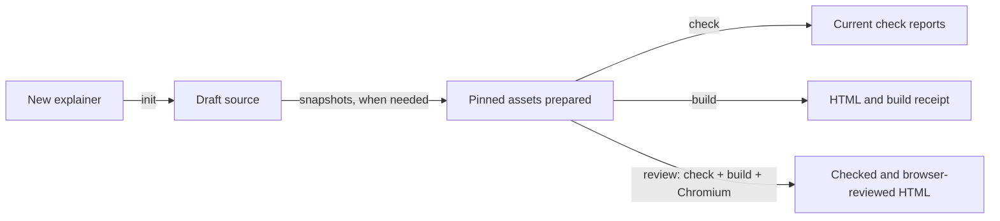

# Rayner's domain model

An explainer connects three things: a model of a system, a sequence of pictures that
explain it, and evidence about the agreement between them. The **script** says what
the reader should learn; the **model** computes what the system does; the **scene**
chooses the steps, pictures and motion. Start here for those relationships, then use
the [tutorial](TUTORIAL.md) for a complete explainer and the
[vocabulary](VOCABULARY.md) for the names.

## State, presentation and a picture

A scene initializes its two authored inputs as class fields. `scene.state` is the
persistent model: tokens left, a door's position, or a cache's contents.
`scene.shown` is presentation: which chapter is visible or which row is emphasised.
A view's `draw(state, shown)` makes the picture from both. Changing the model and
playing `view.sync()` makes the picture follow it.

This fragment shows the separation; a complete explainer also has its script and
tests of the model beside it:

```ts
import { Scene, Text } from 'rayner';
import { stage, view } from 'rayner/explain';

type Model = { tokens: number };
type Shown = { chapter: 'supply' | 'request' };

export default class Bucket extends Scene {
  override state: Model = { tokens: 3 };
  override shown: Shown = { chapter: 'supply' };

  override async construct() {
    const s = stage(this);
    const readout = view(this, (state, shown) =>
      new Text(`${shown.chapter}: ${state.tokens} tokens`, { font: 'mono' }));

    await this.step('supply', { title: 'Three tokens are available' });
    await s.enter(readout, { describe: () => `${this.state.tokens} tokens available` });

    await this.step('request', { title: 'One request spends one token' });
    this.state = { tokens: this.state.tokens - 1 };
    this.shown = { chapter: 'request' };
    await readout.sync({ match: 'text' });
  }
}
```

The counter is model state; the word `request` is presentation. The description of
the picture is derived from what is drawn. It belongs to neither authored object.
The [views guide](VIEWS.md) explains identity, placement and how a sync plays.

## A local example does not replace the model

Sometimes a step teaches with a separate specimen. `s.steps` gives each such step
its own `state` and `draw`, without changing `scene.state`. For example, after the
request above, the model still has two tokens while this step shows an empty bucket:

```ts
await s.steps([{
  id: 'empty-example',
  title: 'An empty bucket cannot supply a token',
  line: 'Compare a bucket with no tokens left.',
  caption: 'This is a separate example. The request above left two tokens.',
  state: { tokens: 0 },
  draw: (state) => new Text(`${state.tokens} tokens`, { font: 'mono' }),
  describe: (state) => `A separate bucket with ${state.tokens} tokens`,
}]);
```

Place that fragment inside `construct`, where `s` is in scope. Its trace keeps
`before.tokens === 2`, `after.tokens === 2` and `state.tokens === 0`. The first two
are the persistent model; the third is the local `StepRecord.state`. A field called
`tokens` can legitimately occur in both. Combining them would lose information.
`meta.watch` names each selected source explicitly. Model selections show real
changes; local, shown and derived selections show current values without mixing
their owners. The description of a staged step uses its local specimen. [Typed state and shown](REFERENCE.md#typed-state-and-shown)

## What a run records

Each channel has one owner and one purpose:

| Channel | What it contains | Example |
| --- | --- | --- |
| `scene.state`, serialized by `stateJson()` | Authored persistent model only; traced as `before` and `after` | `{ tokens: 2 }` |
| `scene.shown`, serialized by `shownJson()` | Authored presentation only; traced as `shown` when present | `{ chapter: 'request' }` |
| `StepRecord.state` | A staged step's optional local input | `{ tokens: 0 }` |
| `derivedJson()`, traced as `derived` | Derived data registered with `addJson(part)` | The stage's `derived.picture` description |
| `record(kind, data)`, traced as `evidence` | Facts about what played | An event, a matching decision, or a diagram traversal |

Helpers cannot add fields to the serialized model or presentation. The engine
validates derived JSON without knowing what an explainer's picture means. A
`diagram.walk` records `diagram-walk` evidence with `from`, `to`, `edge` and an
optional `step`; it does not create `state.walks`. If a route or history is part of
the system being explained, declare it in `Model` and compute it with the model.
Evidence recorded before the first step belongs to the trace's top-level
`evidence`; evidence during a step belongs to that step alone.

A **trace** records a run's steps and these channels. A **build receipt** identifies
the inputs and output of a built page. A check or browser review supplies further
evidence about specific properties; it does not establish that every caption is
true or that a reader learned the intended lesson. The [engine map](ENGINE.md)
explains the invariants, and the [reference](REFERENCE.md#checks) states the checks'
scope and limits.

## Events and motion have different jobs

A `Machine` connects the model's `next(state, event)` to its views. `send` submits
one event; `sendSequence` submits an ordered list, whether freshly authored for a
guided explanation or taken from a reader's recorded events. For the
[tutorial's door](../scenes/tutorial/door/scene.ts), starting open:

```ts
await machine.send('close');
await machine.sendSequence(['lock', 'unlock', 'open']);
```

Use `send` when a guided step or an interaction submits one event. Use
`sendSequence` for a known path through the model, such as a whole demonstration,
a regression example, or a reader's recorded event list. For example, with the
scene initialized to that recording's starting state:

```ts
const recordedEvents = ['close', 'lock', 'unlock', 'open'] as const;
await machine.sendSequence(recordedEvents);
```

Both default to the scene's current state. A sequence checks every event against
the state the preceding event would produce before any of it plays. It does not
reset to `machine.spec.start`; a supplied `from` describes the state the action
must play from, rather than resetting the scene to that state. Both return an
`Action`: await it to play it, or pass it to `play()`, a `Succession` or a group.
`machine.offer()` makes reader controls available at a step without sending an
event. [Machines](MACHINES.md)

The verbs identify the layer doing the work: a model computes a next state, a view
**draws** it, a sync **animates** the picture to it, and the scene **plays** an action
on its clock. An event-driven API uses `send` for both individual and sequenced
events. Calling one `send` and the other `playSequence` would make the same model
operation sound like two different mechanisms. Animation names such as `FadeIn`,
`Transform` and `play` still describe motion; domain names such as `request` or
`close` still describe the system. [Vocabulary decisions](VOCABULARY.md#decisions)

## The CLI workflow and its evidence

The CLI has an implicit workflow, rather than a persistent state machine with
flags such as `isChecked`. These arrows name what a successful command produces
for particular inputs:



`init` writes the draft's starting files. `snapshots` prepares pinned diagram and
lettering assets when the scene needs them; ordinary scenes need no capture step.
`check` runs model tests and scene checks, `build` writes a deliverable, and `review`
includes both before checking the served page in Chromium. A successful build
alone does not establish that checks or browser review passed.

```sh
rayner init my-explainer --blank --question 'When can a request spend a token?'
rayner preview my-explainer/scene.ts --watch
# Edit the script, model, tests and scene; the blank starter initially fails checks.
rayner check my-explainer/scene.ts
rayner review my-explainer/scene.ts --out public/my-explainer.html
```

`preview` prepares what is needed, builds and serves the page while you work.
`see` prints one step in the terminal, `describe` prints every scenario and step as
JSON, and `contact-sheet` writes one scenario's resting pictures as an image sheet.
These help an author inspect the work; they do not create a durable qualification
such as "previewed" or "understood". Commands other than `snapshots` and `preview`
consume pinned assets and ask for preparation if those assets are missing or stale.

Editing source, snapshots or review expectations can make earlier evidence stale:
rerun the relevant checks and review for the new inputs. The receipt identifies
the artifact reviewed, so publish that artifact. The full command options and
dependency requirements are in the [CLI reference](REFERENCE.md#command-line).

For a complete first project, follow the [tutorial](TUTORIAL.md). For the names,
use the [vocabulary](VOCABULARY.md); for implementation rules, use the
[engine map](ENGINE.md); for a picture kept equal to its inputs, use
[views](VIEWS.md); for reader-driven models, use [machines](MACHINES.md).
