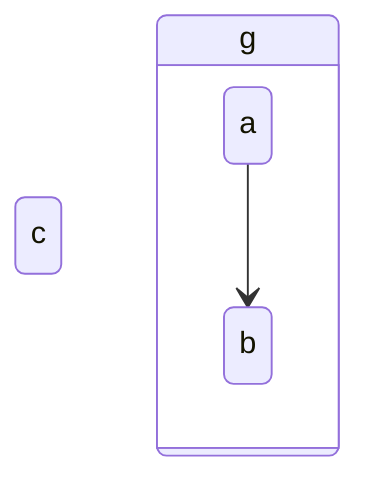

# `make_composite` fails after `remove_transition` in the same edit list

**Versions:** agentic-mermaid 0.5.1 and 0.5.5 (latest), Node 24.

## Reproduction

```js
import { parseRegisteredMermaid, asState, mutate, serializeMermaid } from 'agentic-mermaid/agent';

let d = asState(parseRegisteredMermaid('stateDiagram-v2\n  a --> b\n  a --> c').value);
d = mutate(d, { kind: 'remove_transition', from: 'a', to: 'c' }).value;
const r = mutate(d, { kind: 'make_composite', id: 'g', members: ['a', 'b'] });
console.log(r.ok, r.error?.message);
```

**Actual:** `false State declaration boundary must be an integer within its owning transition sequence`

**Expected:** the edit succeeds and serializes to



## Evidence that the target is valid

- The same two edits in the other order (`make_composite`, then `remove_transition`) succeed on both versions and produce exactly the source above.
- That source parses and verifies in agentic-mermaid 0.5.5 (facts: `composite g; state a parent g; state b parent g; state c; edge a -> b`).
- It renders in Mermaid 12.2.0 (labels a, b, c, g) and in Pele 1.13.0, the renderer behind pele.run (labels a, b, c, g).

So the failure is in the edit, not the diagram. It looks as if the removal leaves the state body's transition sequence with a stale declaration boundary, which `make_composite` then rejects.

## Why it matters

Rayner replays edit lists to verify that one diagram morphs into the next. An author who removes a transition and then groups states has to discover by trial that the order must be reversed.
