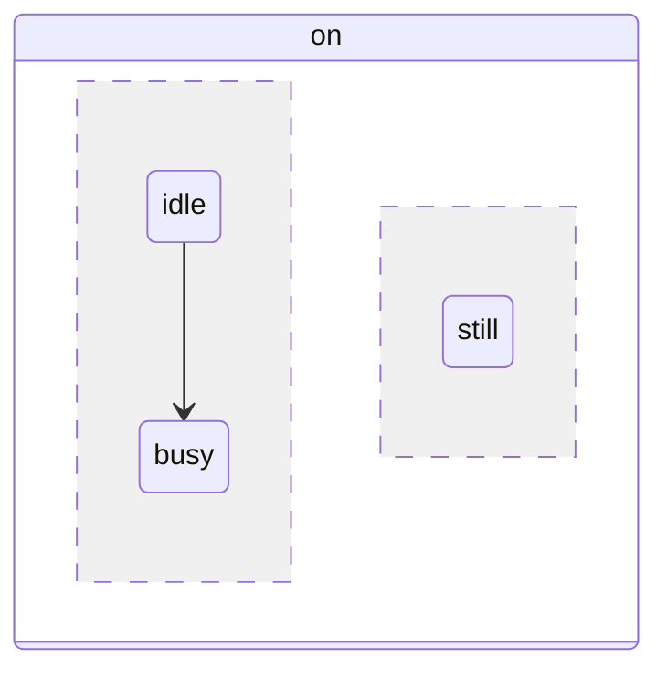

# No edit adds a concurrency region (`--`) to a composite state

**Versions:** agentic-mermaid 0.5.1 and 0.5.5 (latest). The list of state edits (`opSignatures('state')`) is identical in both.

## Reproduction

```js
import { parseRegisteredMermaid, asState, mutate } from 'agentic-mermaid/agent';

const d = asState(parseRegisteredMermaid('stateDiagram-v2\n  state on {\n    idle --> busy\n  }').value);
console.log(mutate(d, { kind: 'add_state', id: 'still', parent: 'on', region: 1 }).error?.message);
console.log(mutate(d, { kind: 'add_transition', from: 'still', to: 'frothing', parent: 'on', region: 1 }).error?.message);
```

**Actual:** both print `Composite 'on' has 1 region/scope(s); region 1 is out of range`. No other state edit (`add_state`, `add_transition`, `make_composite`, `move_state`, …) creates a region.

**Expected:** some edit can turn a one-region composite into two, for example `add_state` with `region` equal to the current region count, or a dedicated `add_region(parent)`, producing



## Evidence that the target is valid

- Adding to a region that already exists works: starting from the target above, `add_state { id: 'x', parent: 'on', region: 1 }` succeeds.
- The target parses and verifies in agentic-mermaid 0.5.5 (facts include `state on region 0` and region 1).
- It renders in Mermaid 12.2.0, which draws two region-divider elements, and in Pele 1.13.0 (pele.run), which draws the dashed divider.

## Why it matters

"A composite gains a parallel region" is the central step when explaining statecharts: for example, a coffee machine's `on` state gains a milk-frother region beside its brewing cycle. Rayner verifies morphs by replaying edits, so this step can only be an unverified visual transition today.
