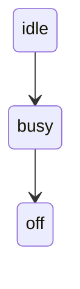
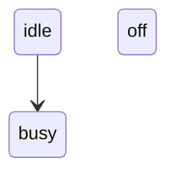

# Removing a state's last transition leaves it declared: expected behaviour, not a bug

**Recommendation: do not file this against agentic-mermaid.** It is recorded here because an earlier report listed it as a third quirk; the reproduction below shows the library behaves correctly. The friction it caused belongs to Rayner (see the end).

**Versions:** agentic-mermaid 0.5.1 and 0.5.5 (latest).

## What was reported

"Edits can declare a state explicitly (for example `off` once its last transition is removed), so the target source has to include that line." In Rayner, a verified morph replays an edit list and requires the result to serialize exactly like the next diagram's source, so an author who left `off` out of the target saw the replay fail.

## Reproduction (`repro/decl.mjs`, `repro/order-layout.mjs`)

Starting from:

`remove_transition { from: 'busy', to: 'off' }` gives:

Compared with three candidate targets, on both versions:

| Target | Same facts | Same canonical source |
| --- | --- | --- |
| `idle --> busy` (no `off`) | no: `off` is gone | no |
| `off` declared before `idle --> busy` | yes | no |
| `off` declared after `idle --> busy` | yes | yes |

## Why this is correct

- Removing a transition should not delete a state. The library has `remove_state(id, recursive?)` for that. A target without `off` needs `remove_state { id: 'off' }` in the edit list, not just the transition removal.
- The edit keeps `off` where it was, after `idle --> busy`. Declaration order is not cosmetic: rendering the two orders gives different layouts (`off` at x = 70 when declared first, x ≈ 165 when declared last; `idle` moves the other way). So a comparison that treats the two orders as different is right for Rayner, whose morph must land on the same picture.

## What Rayner should change instead

`replayMorph` in `integrations/agentic-mermaid/build/index.ts` throws "Morph ops do not produce the next diagram" with no detail. It should report the difference: the facts present in one and not the other (from `describeMermaidFacts`), or the first differing line of the two serializations. Then an author sees "state off: in the edit result, not in the target" and knows to add `remove_state`, or "same facts, different order" and knows to move the declaration.
