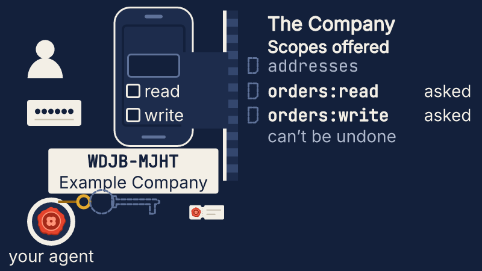
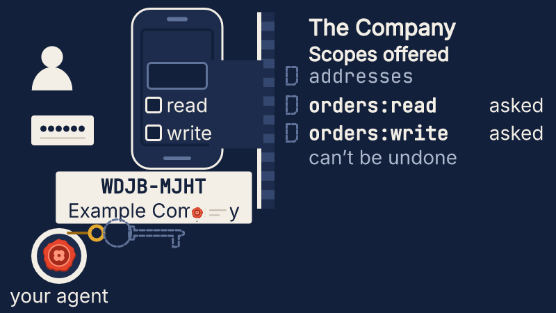

# Foreground glyph occlusion: 20 November 2026

The complete run rejects **32/59**, preserving all thirty previous rejections;
all eight full-event Poppy baselines and the other 44 catalog chapters are clean.
`corpus.json` retains every case, the baseline counts, exact new attributions and
seven historical guard-only refusals. `catalog.json` retains the other chapters.

The direct historical gain is `sign-in-poll-over-card`: in the device flow, the collect
poll crosses the printed company name on the device card. The new check reports
the affected `card`, the words `Example Company`, the foreground `poll`, and the
matching collect transition. An unrelated finding cannot earn this entry credit.

These are the actual frames at 0.967 seconds into collect:

| Fixed route | Reconstructed defect |
| --- | --- |
|  |  |

`report.json` records three frames on each route, at 0.900, 0.967 and 1.000
seconds. The independent verifier removes each of the fourteen non-space glyphs
from the composited SVG and counts the pixels its removal changes. It then
removes the named poll and repeats. Every fixed glyph contributes exactly the
same pixels with or without the poll. In every mutated frame the poll completely
hides at least one glyph and removes at least 90% of two glyphs' contributions.
The verifier never calls the motion detector or uses its coverage geometry.

Reproduce the assertions and fresh artifacts:

```sh
node tools/repo/motion-occlusion-proof.ts
node tools/repo/motion-occlusion-proof.ts --chromium
FULL=1 node --test --test-name-pattern='credited poll mutation' test/motion-corpus.test.ts
node tools/repo/motion-corpus.ts --out out/motion-corpus-improved.json
```

Pinned Chromium 156.0.8078.4 independently painted the sixty middle-frame SVG
controls in a browser canvas. The mutated frame loses all ink from glyphs 12 and
13; removing the poll restores 140 and 117 pixels. Every fixed glyph contributes
the same pixels with or without the poll. The `chromium` section of `report.json`
retains these counts and the browser version. The two PNGs above use Resvg.

The second gain, `sign-in-ask-people-slide`, is a secondary occlusion caused by
the deliberately reconstructed reflow. In direct-flow `reask`, 3.500 seconds
into its first ask, the moving tag entirely hides seven letters of
`Exchange items`. Removing only the tag restores their ink; the fixed layout
preserves every letter. `ask-slide/report.json` and its two PNGs retain the
per-glyph controls. Its credited finding must name the exact transition, label,
words and tag. This rejects a geometric consequence of the mutation; judging
movement's explanatory purpose still requires visual review.

Two Astra 6.2 agents independently challenged the implementation. Their native
SVG raster controls cover front/back paint order, partially obscured long words,
remote repeated words, coincident text handoffs, whole-word replacement, terminal
wipes, a shorter real obstruction before a longer wipe, camera and descendant
clips, invisible glyphs, intrinsic paint alpha, wide stroked glyphs, both fill
rules, and cubic bulges and cutouts. The keepers are
`test/motion-occlusion-adversarial.test.ts` and
`test/motion-corpus-report.test.ts`.

Isolated Node load hooks poisoned in-memory source without editing the working
tree: disabling coverage failed the positive raster-backed assertions; accepting
all fresh findings failed the poll-attribution assertion; ignoring a failed
baseline failed the reporting assertion; and replaying the fixed route as the
mutant failed the independent native pixel proof. Clean controls passed again.

The glyph-dissolve entry is not credited. One scenario's 1,564 affected owner and
close frames were byte-identical to its baseline: those steps now replace all
ledger keys, so changing the glyph-pairing mode does not pair their text. Its
mutation now names the supported `by-place` mode rather than the unsupported
`glyphs` spelling. The entry stays in the denominator as an unreproduced miss.

The baseline review also found shared entrance ordering hiding refusal-slip
labels behind their own newly entered paper. In the identical intermediate frame,
moving only `1.0` to the front restored 435 pixels; the repaired admission order
paints those same 435 without that intervention. The `about` and `403` controls
restore 629 and 4,436 pixels. New target layers now enter in target paint order
around surviving root children; old child order, wrapper clips and passing tokens
remain intact. `test/choreograph.test.ts` rejects the old behavior using actual
raster output and varied construction/replacement orders.

A separate browser record defect allocated both old and new codes to the first
rack slot until the final layout. The original `K9wd` lost all 847 contributed
pixels; removing the new row restored them. Existing rows now move before the new
record enters, and all 847 pixels remain at the sampled times. The scene-owned
fidelity assertion exercises the actual live load press in all three sign-in configurations and
checks every frame for overlapping readable record names. `handoffs.json` retains
the independent before/after native observations for both repairs.

The coverage chapter also kept the prior close-account speech card over the new
gift-card request during its lane search. The new request lost all 1,641 pixels
at three sampled times; removing the old card restored them. The probe now clears
the old request first, and its replacement retains all 1,641 pixels throughout
those samples. The scene-owned test rejects the old overlap in both company
configurations; its native observations are also in `handoffs.json`.

The detector certifies coverage of glyph boxes by a single opaque fill. It does
not establish complete composited text visibility or combine several smaller
masks. The independent raster proof establishes the intended visible defect in
this newly credited case. Causality, movement's explanatory purpose and pacing
continue to need authored meaning and visual review.

The historical engine defect on the conversations owner step remains a miss
outside the 59. A load hook restored the earlier admission mechanism by adding
all new text frames before the new shapes. The original engine commit was
unavailable in this checkout. At 0.700 and 0.767 seconds the place card's words
contributed 2,171 and 2,224 pixels in the baseline and zero in both reversed
frames. Both orders produced 2,224 pixels at 0.800 seconds. The words acquired
their `owner:card` keyed ancestor only at that final handoff, so the detector
reported no occlusion. In the recorded frames, `n` counts the pixels changed by
removing these words from the 800-pixel-wide SVG raster. [Baseline](engine-order-baseline.json) · [Reversed admission order](engine-order-frames-first.json)
