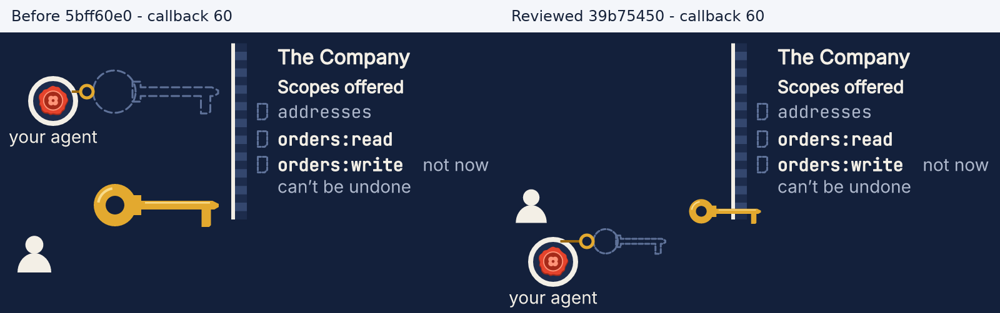
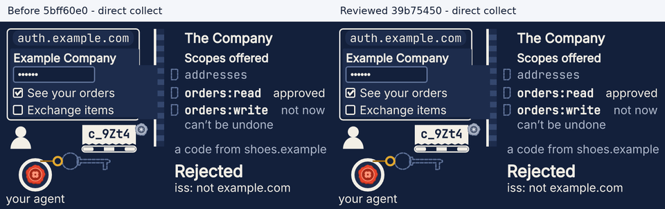
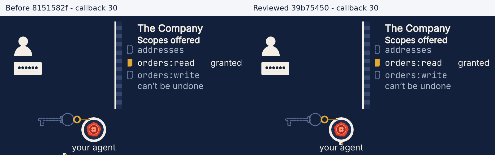
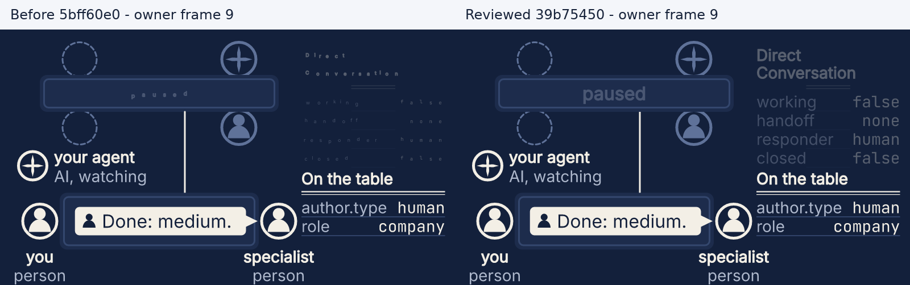
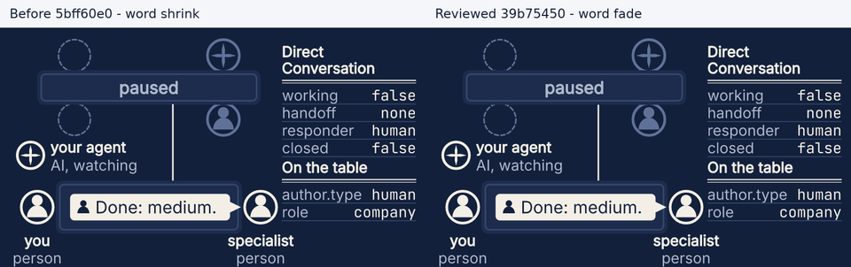
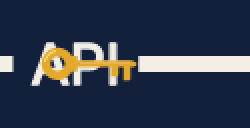
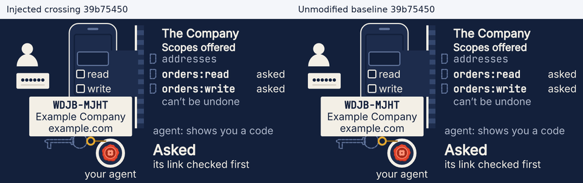

# Motion repairs: visual review guide

Start with the three product comparisons below. Open an original image for native 800×450 pixels, or expand a motion preview. The four diagnostic controls are separate: they show deliberately injected defects, not four current baseline bugs.

**[Download the offline gallery](offline-gallery.zip)** for larger paired pictures and videos with playback controls. Extract the ZIP and open `index.html`. If your browser blocks local files, run `python -m http.server 8000 --bind 127.0.0.1` in the extracted directory and open `http://localhost:8000`. The gallery needs no external network resources. [HTML source](index.html) · [Frame and source manifest](manifest.json) · [Independent source-39 review](../motion-consumer-binding-2026-11-23/independent/REPORT.md)

## 1. The recipient remains visible during a grant

**Look at the person, agent and ring.** The old composition removes/repositions them during collection; the reviewed composition keeps the recipient in place while the grant arrives. These use the same direct `collect` event, source model and accepted `ask → approve-read → trick → collect` history.



[Original before](media/grant-before.png) · [Original reviewed](media/grant-reviewed.png). The static pair is callback 60, +2 s on the recorded frame clock.

<details>
<summary>Play the complete matched grant event — 135 callbacks, 4.5 s at 30 fps</summary>



[Full-resolution MP4](media/grant.mp4). **Pause near +1.70 s (callback 51): the old recipient field is empty while the reviewed person, agent and ring remain visible.** Left: `5bff60e0`; right: `39b75450`. Each side contains every recorded callback once. Boundary bookkeeping is included; the authored event mark is 4.45 s. There is no interpolation or speed normalization.

</details>

## 2. A returned credential stays inside the stage

**Look just below the agent ring.** Part of the earlier device return's small punched tag falls below the bottom edge. The reviewed route keeps the whole traveller onstage. Both pictures are callback 30 of first-grant, ordinary device disconnect, from the same `rest` root and event log.



[Original before](media/return-before.png) · [Original reviewed](media/return-reviewed.png). Left: `8151582f`; right: `39b75450`. This is a real earlier regression and its repair, not an injected camera-edge control.

<details>
<summary>Enlarge the bottom-left region without changing its pixels</summary>

| Before: tag clipped at the bottom | Reviewed: whole tag visible |
| --- | --- |
|  |  |

The crop is `(110, 300, 320, 150)` on the original 800×450 canvas, enlarged 2× with nearest-neighbour sampling. The wider claim comes from the independent actual-reader review: all 16 legal histories, 704 visible callbacks, no offstage native contribution. This one pair does not claim to show every history.

</details>

## 3. Whole words fade without shrinking into dots

**Look at the outgoing “Direct Conversation” readout.** The old transition shrinks separate letters; the reviewed transition preserves word shapes while fading them. The pictures use native `owner` offset 9 on both sources.



[Original before](media/words-before.png) · [Original reviewed](media/words-reviewed.png).

<details>
<summary>Play the matched opening transition — 41 callbacks, 1.367 s at 30 fps</summary>



[Full-resolution MP4](media/words.mp4). Left: `5bff60e0`; right: `39b75450`. These are the first 41 emitted callbacks of the `owner` step, including its original first caption hold after the transition. Later holds and the `close` step are outside this excerpt; it is not a whole-chapter pacing comparison.

</details>

## 4. What the diagnostics must distinguish

Both columns below come from **the same reviewed source `39b75450`**. The left column has the original deliberate mutation; the right is the unmodified baseline at the same native offset. These are checker controls, not historical before/after product repairs. Crops are enlarged 2× with nearest-neighbour sampling; click the full-image links for context.

| Exact relation | Injected defect | Clear baseline |
| --- | --- | --- |
| Key over **Sign-in**, `approve/sign-in`, offset 37. [Full injected](media/poppy-injected.png) · [Full clear](media/poppy-clear.png) |  |  |
| Refreshed key over **API**, `slip/answer`, offset 38. [Full injected](media/api-injected.png) · [Full clear](media/api-clear.png) |  |  |
| Outgoing poll over **example.com**, `ask/collect`, offset 26. Inspect the final **m**. [Full injected](media/domain-injected.png) · [Full clear](media/domain-clear.png) |  |  |
| Forged slip over SID **Yx2b7Q**, `forge`, offset 36. The separate **Session** label stays clear. [Full injected](media/sid-injected.png) · [Full clear](media/sid-clear.png) |  |  |

<details>
<summary>Play the complete device poll control — 85 callbacks, 2.833 s at 30 fps</summary>



[Full-resolution MP4](media/domain-control.mp4). Both sides are source `39b75450`; the left has the injected crossing. Later Company-line contact is a different victim. The earlier generic domain representation retains its miss; the separately registered exact domain-clearance representation matches. Four physical relations have matching representations across five versions, not five separate defects.

</details>

## Sources, timing and limits

- Historical source: `5bff60e0aa5660c2b944fb59fbfe0b59e703db93`. Earlier return: `8151582fc8a4ff2d06d6b4e5607633e0474c0dbf`. Reviewed rendering: `39b75450eeb4ef9082ec22a93be099770365d715`.
- The reviewed rendering is unchanged in PR code checkpoint `20fe61ee`; subsequent guide changes are presentation only. The source-39 native pictures retain their source label. Original case/side receipt digests, offsets, pixel hashes, selected clip inputs and output hashes are in [manifest.json](manifest.json).
- The 14 full-size original PNGs are copied byte-for-byte. Paired posters add labels outside the native images. Crops duplicate original pixels. GIF and H.264 previews are display derivatives: GIF quantizes colours and centisecond timing; MP4 retains the selected 30 fps callback sequence with ordinary video compression. Use original PNGs for pixel judgments.
- No sparse contact sheet has been animated into a purported continuous journey. No frame interpolation, retiming, mid-event omission or artificial pause is used. The word excerpt is explicitly bounded. Static pictures do not prove general pacing or causality.
- This guide is a selection. The [full evidence guide](../motion-consumer-binding-2026-11-23/README.md) retains all 59 dispositions, 507 selected witnesses and the independent reviews. It does not imply 59 current bugs or a detection-accuracy score.

## Reproduce or verify

`build.ts` needs Node 24, Python 3, FFmpeg (with `drawtext`, `libx264` and palette filters) and DejaVu Sans. It reads retained original capture directories; it never runs the renderer or rewrites an old receipt. Supply the roots from an exact capture checkout or extracted retained media:

```sh
node docs/evidence/motion-visual-guide-2026-11-23/build.ts \
  --historical /path/to/current-audit-2026-11-22 \
  --reviewed /path/to/root-causes-native-39b75450 \
  --return-before /path/to/astra-attempt-2/reader-return \
  --return-after /path/to/astra-attempt-3/reader-return
```

The historical and reviewed roots need the complete input frames for these three clips, not only the 507 selected-picture archive. Each root's actual case revision, status, FPS, frame inventory and matched model are checked before export. Readable output and the offline gallery need none of those roots.

Run `python docs/evidence/motion-visual-guide-2026-11-23/verify.py` with Pillow and `ffprobe`. This checks the published original RGBA pixels against their native ledgers, unchanged poster regions, exact crop pixels, artifact hashes, clip frame counts/rate/duration and offline bundle inventory. It does not replace independent semantic review of the scene.

`build.ts` also runs [bundle.py](bundle.py). Run that script alone after editing the gallery page; it deterministically repacks the declared media without rebuilding clips. [browser-check.ts](browser-check.ts) checks playback, seeking, image loading, keyboard access and overflow at 1280/390 px, then tests a fresh bundle extraction on localhost with outside requests blocked. Direct file opening may be denied by a managed browser policy; it is reported separately from the verified local-server fallback.
