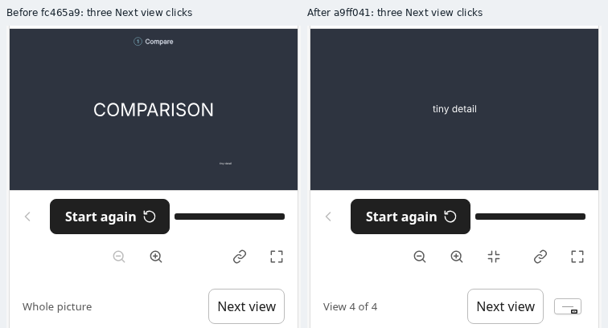

# PR #69: second adversarial audit

Four independent reviews examined reader navigation, factual claims, screenshot-based reader journeys and the review gates at `fc465a9b9771a92248d57be6cccb94a1960071bd`, against main `fed1f3260237d0e76dfa61f21b2ba72f8ad66953`. Follow-up reviewers challenged the repairs with separate probes. The preceding [CI run](https://github.com/adewale/rayner/actions/runs/41221281447) passed every job at that starting revision; these findings expose cases its tests did not generate.

## Findings

| Priority | Defect | Repair and regression |
| --- | --- | --- |
| P2 | Next view stalled when an authored opening used 1× and later stops zoomed in. The reader inferred Whole picture from scale alone, reset to the first stop, and never advanced. | Track the existing tour-following state and selected stop when distinguishing Whole picture. The served regression checks actual viewBox changes, counters, explicit Whole picture/resume and manual zoom-out/resume. Restoring the old reader fails on the unchanged viewBox. |
| P2 | Imported lettering used its axis-aligned height as its font-size measure. A five-letter Paper label compressed to about 0.3 CSS pixels wide still passed a 14.4px receipt. | Use a shared conservative font-basis metric for native and imported labels, accounting for captured transforms, forced widths and later affine maps. A genuine committed diagram snapshot supplies the readable/thin browser control. The old height-only metric makes that regression fail. |
| P2 | The new 320px gate accepted required shapes and words hidden behind opaque artwork. Its geometry checks did not establish visible contribution. | Compare native browser composites for each required subject and its labels. Fully covered shapes reject; label cores must retain their visible contribution. Real CSSOM controls reject full/partial covers and a thin crossing under the served CSP. |

The font-metric repair keeps transform-only data out of layout bounds and drawable admission. Independent probes found and verified repairs for ordinary imported/native morphs, different-word bounds, nested matching compression, matching in both directions, and a zero-em source that initially produced NaN frame coordinates. Native `Text.textSize()` keeps its existing contract. Existing text/layout points retain their default bounding behavior.

The paint repair also rejects unsupported masks, filters, paint servers, CSS path replacement and rounded clip rectangles. Otherwise those effects could erase text and shrink the mask used to judge it. The final normalization preserves disabled fill/stroke channels, so valid outline-only lettering and a disabled non-none stroke remain accepted. Independent native reproductions verify the rejection paths; the positive cases keep dimming, translucent overlays and supported rectangular clipping.

## Matched navigation evidence

Claim: after three Next view clicks, a tour with a 1× authored opening reaches its complete detail view.

Input is the exact fixture from `test/explain-embed.test.ts`, test `Next view leaves an authored whole-frame opening and distinguishes Whole picture from its first stop`: `COMPARISON` at 1em, a 0.15em detail at `[4,-3]`, the large word declared as the opening subject. Both revisions use 390×844, reduced motion, empty settings and step `compare`.

Inspect the view counter and the small detail. The baseline stays at the identity viewBox after all three clicks; the repair visits four distinct views and ends with the detail at 12.00000262 CSS pixels. The [receipt](pr69-second-audit/navigation/receipt.json) includes the exact fixture, model state, action sequence, source/build/artifact hashes and unscaled lossless pixel hashes. It identifies both render revisions explicitly. The final reviewer-only follow-up rebuilds to the exact same HTML; its separate validation field records the later source and build hash without relabelling the original screenshots.

Regenerate with `EXPLAIN_BROWSER=1 node --test --test-name-pattern='Next view leaves an authored whole-frame' test/explain-embed.test.ts`. The served test asserts actual navigation and detail scale; it is independent of the comparison image.

## Other review results

The semantic review found no new factual error in the 30 teaching readers or the native dictionary, Bloom-filter, Git, Monty Hall, birthday and music lessons. Independent probes checked both Bloom sizes and all three Tailwind/P3 comparisons. This does not prove browser visibility.

The screenshot review inspected seven explainers, including alternate settings, at 320/390px and 1180×560, plus disclosures, return navigation, keyboard Home/End and French watch readouts. Its 30 main, nine interaction and five French captures found no additional PR regression. A rendered baseline confirms a short-desktop limitation for WCAG A/4.1 at 1180×560: both main and the PR use a 320px player beside an 828px rail. Next sits at y660–700 on main and y570–610 in the PR, below the viewport in both; the PR moves it upward by 90px. This establishes inheritance for that case, rather than every scene. Scrolling remains available.

## Validation

The [validation record](pr69-second-audit/validation.json) pins the commands, revisions and log hashes:

- At `a9ff041885dacac8a75b4b0c33708eb8436698c9`, the full standard suite passes 1,009 tests with 140 explicit optional skips, no failures and no cancellations. This is a clean invocation.
- All 107 tests in the four affected browser-owner files pass, with no skips: `explain-embed`, `explain-reading`, `explain-story-review` and `explain-player-style`. They include all catalog pages standalone/embedded, every case's teaching-step bar, action/history/motion properties and retained source tours.
- The final reviewer-only disabled-channel correction at `dd749be6536158b1c72b0170a2ef3641009d08e6` passes type checking and the expanded native-CSP owner. It changes no reader, engine or scene code. A fresh production build produces the exact HTML captured in the navigation pair.
- Browser-enabled installed-package smoke passes on the same final build-input hash, `2915a59118252da463908b91959d659f9e7ed7c3d84479675dbab8468021761c`. It checks archive installation, the typed consumer, compiled CLI/engine and installed capture/authoring.

The negative controls reject the original tour reset, height-only imported metric and old mask normalization. Separate reviewers reproduced and then rejected the mask, rounded-clip and transparent-paint bypasses. The full catalog/story and compatibility CI owners must rerun on the pushed head.

The [first audit](pr69-adversarial-audit-2026-10-31.md) and its matrices remain evidence for their pinned revisions. The full catalog/story matrix and Mac/Safari owners must validate the newly pushed revision before merge.

## Limits

Native composite checks added here cover required 320px openings. The existing complete 390/1180 tour review remains. Named shapes need a visible contribution; label checks require at least 99% of significant glyph-core pixels to retain at least half their unobscured, last-painted contribution. They tolerate antialiasing and do not establish absolute contrast, every browser composition effect, physical-phone performance or learning outcomes. Reference views can still use several stops. This audit includes no merge, publication or deployment.
